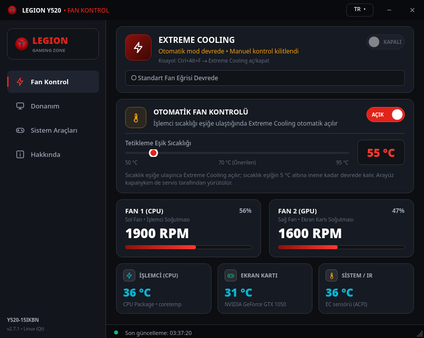
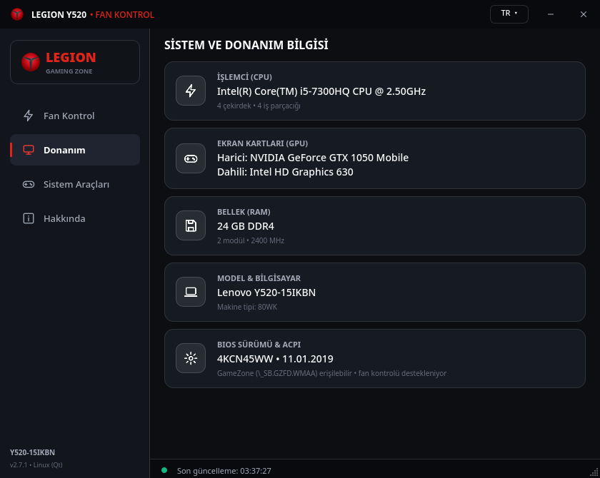
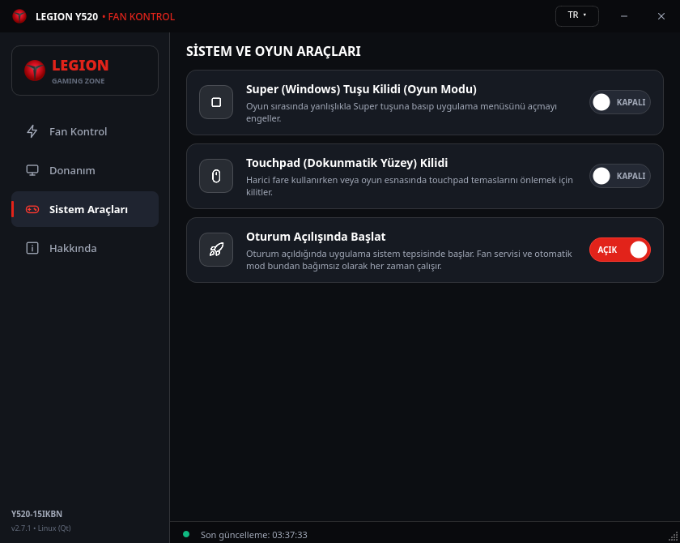
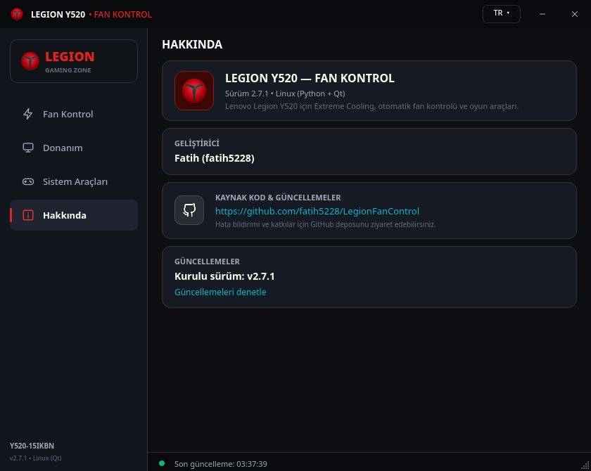

# Legion Y520 — Fan Kontrol (Linux)

Windows sürümünün Linux karşılığı: aynı arayüz, aynı özellikler. Python + Qt (PySide6) ile yazıldı;
KDE Plasma'da test edildi (CachyOS, Wayland).

The Linux port of the Windows app — same UI, same features. Written in Python + Qt (PySide6),
tested on KDE Plasma (CachyOS, Wayland).



| Donanım / Hardware | Sistem Araçları / System Tools | Hakkında / About |
|---|---|---|
|  |  |  |

## Nasıl çalışır / How it works

Windows sürümü `root\wmi:LENOVO_GAMEZONE_DATA` WMI sınıfını çağırır; WMI bu çağrıları firmware'deki
`\_SB.GZFD.WMAA` ACPI metoduna yönlendirir. Linux sürümü aynı metodu
[acpi_call](https://github.com/nix-community/acpi_call) çekirdek modülüyle doğrudan çağırır.

```
legion-fan-control (Qt arayüz, kullanıcı)
        │  D-Bus (sistem veriyolu)
        ▼
legion-fan-control.service (root)  ── otomatik mod burada çalışır
        │  /proc/acpi/call
        ▼
\_SB.GZFD.WMAA  →  EC (gömülü denetleyici)
```

- **Servis (root):** donanıma tek erişen süreç. Otomatik modu yürütür; arayüz kapalıyken de çalışır.
- **Arayüz (kullanıcı):** servise D-Bus ile bağlanır. Değişiklik yetkisi `wheel` grubundadır;
  diğer kullanıcılar yalnızca durumu okuyabilir.

| WMI metodu | WMAA no. | Firmware |
|---|---|---|
| GetCPUTemp (EC) | `0x01` | EC `CPUT` |
| GetFan1Speed / GetFan2Speed | `0x08` / `0x09` | `FANS`×100 / `FA2S`×100 |
| GetFanMaxSpeed | `0x0A` | sabit 3400 |
| SetFanCooling | `0x0D` | EC komutu `0x59`: `0x77` aç / `0x76` kapat |
| GetFanCoolingStatus | `0x14` | `FCST` bit 0 |
| Set/GetWinKeyStatus | `0x16` / `0x17` | `GDST` = 2 |
| Set/GetTPStatus | `0x19` / `0x1A` | `GDST` = 4 |

Numaralar Y520-15IKBN (BIOS 4KCN45WW) DSDT'sinden çıkarıldı. Başka modellerde farklı olabilir.

### Desteklenen model / Supported model

Servis yalnızca **Lenovo Y520-15IKBN** üzerinde (DMI `product_version` ya da anakart `Provence-5R1`)
donanıma erişir. Başka bir modelde aynı metot numarası farklı bir EC komutu olabileceğinden, diğer
modellerde `/proc/acpi/call`'a hiç yazılmaz; arayüz "Desteklenmeyen model" gösterir.

The service only touches the hardware on the **Lenovo Y520-15IKBN**. On other models the same method
number may be a different EC command, so `/proc/acpi/call` is never written and the UI shows
"Unsupported model".

Kendi sorumluluğunuzda başka bir modelde denemek için (önce DSDT'nizi inceleyin!):

```bash
sudo systemctl edit legion-fan-control    # [Service] altına: Environment=LEGION_FAN_FORCE=1
```

## Kurulum / Installation (Arch, CachyOS, Manjaro…)

### AUR (önerilen / recommended)

[](https://aur.archlinux.org/packages/legion-y520-fan-control-git)

```bash
paru -S legion-y520-fan-control-git      # ya da / or: yay -S legion-y520-fan-control-git
sudo systemctl enable --now legion-fan-control.service
```

Pamac kullanıyorsanız: *Paket Ekle/Kaldır → AUR* sekmesinde `legion-y520-fan-control-git` arayın.
Bu bir `-git` paketidir: GitHub'daki her güncelleme bir sonraki sistem güncellemesinde gelir.

This is a `-git` package: every change on GitHub arrives with your next system upgrade.

### Kaynaktan / From source

```bash
git clone https://github.com/fatih5228/LegionFanControl.git
cd LegionFanControl/linux
makepkg -si
sudo systemctl enable --now legion-fan-control.service
```

Ardından uygulama menüsünden **Legion Y520 Fan Kontrol**'ü açın.

> **Secure Boot:** `acpi_call-dkms` modülü DKMS ile imzalanır. Çekirdek kilitleme (lockdown)
> `integrity`/`confidentiality` modundaysa `/proc/acpi/call` kullanılamaz.

**Kaldırma / Uninstall:** `sudo pacman -R legion-fan-control`

## Windows'tan farklar / Differences from Windows

| Windows | Linux |
|---|---|
| LibreHardwareMonitor | `coretemp` (CPU), `nvidia-smi` (GPU) |
| Görev Zamanlayıcı ile başlatma | systemd servisi + oturum açılışında tepsi (`~/.config/autostart`) |
| `RegisterHotKey` (Ctrl+Alt+F) | KDE global kısayolu (`/usr/share/kglobalaccel`); *Sistem Ayarları → Kısayollar*'dan değiştirilebilir. İlk kurulumdan sonra oturumu kapatıp açın |
| Windows tuşu kilidi | Aynı EC kilidi — Linux'ta Super tuşunu kilitler |

- Hibrit grafikte NVIDIA kartı uykudaysa GPU sıcaklığı okunmaz (kartı uyandırmamak için); kart "Uykuda" görünür.
- Ayarlar: arayüz dili `~/.config/legion-fan-control/settings.ini`, otomatik mod ve eşik
  `/var/lib/legion-fan-control/state.ini`.

## Sorun giderme / Troubleshooting

```bash
systemctl status legion-fan-control          # servis durumu
journalctl -u legion-fan-control -b          # servis günlüğü
lsmod | grep acpi_call                       # modül yüklü mü
busctl --system call io.github.fatih5228.LegionFanControl \
  /io/github/fatih5228/LegionFanControl io.github.fatih5228.LegionFanControl GetState
```

| Belirti | Çözüm |
|---|---|
| "Servise ulaşılamıyor" | `sudo systemctl enable --now legion-fan-control` |
| "İzin yok" | Kullanıcınızı `wheel` grubuna ekleyin |
| GPU "Okunamadı" | NVIDIA sürücüsü güncellendiyse yeniden başlatın (sürücü/kütüphane uyuşmazlığı) |
